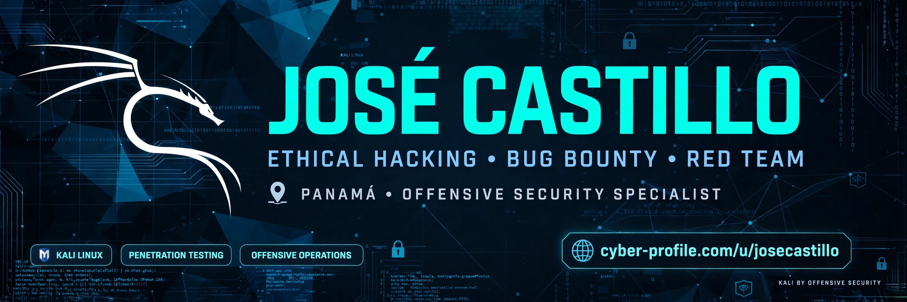

# Hola, soy José Castillo 👋

Especialista en **ciberseguridad ofensiva** y **bug bounty hunter** 🇵🇦 — Panamá

Dueño y gerente de **GlobalTrackExpress** (desde 2024), empresa de logística en Panamá. En ciberseguridad trabajo solo en programas autorizados, siempre con autorización y alcance definido.

  

Mi GitHub contiene los proyectos y herramientas de mi trabajo en seguridad ofensiva: búsqueda de vulnerabilidades en programas autorizados, siempre con autorización y alcance definido.

## 📂 Proyectos

Los proyectos se anuncian aquí cuando están terminados y probados.

- **atlas-lab** — laboratorio privado de caza de bug bounty: método ATLAS, actas y evidencia.
- **kali-lab** — entorno atacante (Kali) del laboratorio.
- **qwen-atlas** — modelo propio de IA para el laboratorio, con [ciclo de entrenamiento en GitHub Actions](https://github.com/ATLAS-PTY/atlas-lab/actions/workflows/entrenamiento.yml).

## 🧪 Laboratorio

Laboratorio privado de ciberseguridad ofensiva y defensiva: equipo rojo (caza de vulnerabilidades en programas autorizados) y equipo azul (defensa y monitoreo).

## 🤖 IA

- **Qwen-Atlas** — modelo propio para el laboratorio.
- **USAP + PentAGI** — agentes autónomos de seguridad y threat hunting con IA.

## 🛠️ Herramientas

- **OSINT:** Sherlock, SpiderFoot, Mr.Holmes, OsintHunter, MISP.
- **Red team:** RustScan, Amass, PentAGI, Hexstrike.
- **Blue team / SOC:** Velociraptor, TheHive, Hayabusa, SentinelSOC.
- **IA y automatización:** USAP, HaxBox, cybersec-toolkit.
- **Kali:** nmap, sqlmap, nikto, hydra, nuclei, subfinder, ffuf.

## 🎯 Bug bounty

Ruta ATLAS: Bugcrowd → HackerOne → YesWeHack → Intigriti.

- **Bugcrowd** — trabajo activo. Skyscanner (primer programa que paga) y NASA VDP.
- **HackerOne** — cuenta [josecastillo-pty](https://hackerone.com/josecastillo-pty).
- **YesWeHack** — cuenta activada.

## 🎓 Cursos y certificaciones

- **Cisco — Introduction to Cybersecurity** — certificado verificado (Credly, sincronizado en CyberProfile).
- **Cisco — Networking Basics** — certificado verificado (Credly, sincronizado en CyberProfile).
- **Cisco — Networking Devices and Initial Configuration** — certificado verificado (Credly, sincronizado en CyberProfile).
- **OPSWAT ICIP** — completado 100% (certificado paZt5da78w).
- **OPSWAT OCFA** — certificado pAMj6ied3w.
- **Aprende.org** — Diplomado Técnico en Sistemas Informáticos y Diplomado Técnico en Integridad Web.

## 🌐 Redes sociales

- 💼 Portafolio: [cyber-profile.com/u/josecastillo](https://cyber-profile.com/u/josecastillo)
- 💼 LinkedIn: [linkedin.com/in/joseecastillo](https://www.linkedin.com/in/joseecastillo)
- 📸 Instagram: [@josecastillo.pty](https://www.instagram.com/josecastillo.pty)
- 🧵 Threads: [@josecastillo.pty](https://www.threads.com/@josecastillo.pty)
- 👍 Facebook: [Jose Castillo](https://www.facebook.com/profile.php?id=61595531332609)
- 🎵 TikTok: [@josecastillo.pty](https://www.tiktok.com/@josecastillo.pty)
- X: [@JoseCastillo_pty](https://x.com/JoseCastillo_pty)
- ▶️ YouTube: [@JoseCastillo_pty](https://www.youtube.com/@JoseCastillo_pty)
- 🐙 GitHub: [ATLAS-PTY](https://github.com/ATLAS-PTY)
- 🎯 HackerOne: [josecastillo-pty](https://hackerone.com/josecastillo-pty)
- ☕ Buy Me a Coffee: [buymeacoffee.com/josecastillo](https://buymeacoffee.com/josecastillo)

## 🏆 Logros

- **Cisco (verificado en Credly / CyberProfile):** Introduction to Cybersecurity, Networking Basics, Networking Devices and Initial Configuration.
- **Aprende.org (verificado en CyberProfile):** Diplomado Técnico en Sistemas Informáticos y Diplomado Técnico en Integridad Web.
- **CyberProfile:** perfil verificado — LinkedIn y YouTube verificados, y 5 certificaciones verificadas sincronizadas con Credly. Ver perfil: [cyber-profile.com/u/josecastillo](https://cyber-profile.com/u/josecastillo).
- **Bug bounty:** cuenta HackerOne [josecastillo-pty](https://hackerone.com/josecastillo-pty); trabajo activo en Bugcrowd (Skyscanner y NASA VDP); cuenta activada en YesWeHack.

## 💻 Lenguajes

- **Python** — usado en mis repos (atlas-lab, equipo-agentes, Agentic-Bug-Hunter).
- **Bash / Linux** — scripting y trabajo diario en Kali Linux (kali-lab, herramientas-instalacion).
- **Redes** — fundamentos y configuración de redes (certificaciones Cisco de Networking; Técnico en redes de datos, Aprende.org).

## 🐍 Contribuciones

La serpiente se genera cada día con GitHub Actions ([.github/workflows/snake.yml](https://github.com/ATLAS-PTY/ATLAS-PTY/blob/main/.github/workflows/snake.yml), gratis, con Platane/snk).
