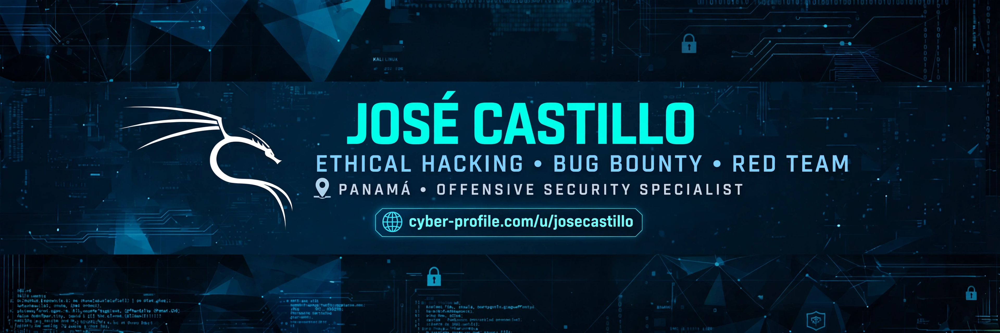

# Hola, soy José Castillo 👋

Especialista en **ciberseguridad ofensiva** y **bug bounty hunter** 🇵🇦

  

Mi GitHub contiene los proyectos y herramientas de mi trabajo en seguridad ofensiva: búsqueda de vulnerabilidades en programas autorizados, siempre con autorización y alcance definido.

## 📂 Proyectos

Los proyectos se anuncian aquí cuando están terminados y probados.

- **atlas-lab** — laboratorio privado de caza de bug bounty: método ATLAS, actas y evidencia.
- **kali-lab** — entorno atacante (Kali) del laboratorio.
- [**qwen-atlas**](https://github.com/ATLAS-PTY/atlas-lab/actions/workflows/entrenamiento.yml) — modelo propio de IA para el laboratorio, con ciclo de entrenamiento en GitHub Actions.

## 🧪 Laboratorio

Laboratorio privado de ciberseguridad ofensiva y defensiva: equipo rojo (caza de vulnerabilidades en programas autorizados) y equipo azul (defensa y monitoreo).

 
 
 
 

## 🤖 IA

- **Qwen-Atlas** — modelo propio para el laboratorio.
 
- **USAP + PentAGI** — agentes autónomos de seguridad y threat hunting con IA.

## 🛠️ Herramientas

- **OSINT:** Sherlock, SpiderFoot, Mr.Holmes, OsintHunter, MISP.
- **Red team:** RustScan, Amass, PentAGI, Hexstrike.
- **Blue team / SOC:** Velociraptor, TheHive, Hayabusa, SentinelSOC.
- **IA y automatización:** USAP, HaxBox, cybersec-toolkit.
- **Kali:** nmap, sqlmap, nikto, hydra, nuclei, subfinder, ffuf.

## 🎯 Bug bounty

Ruta ATLAS: Bugcrowd → HackerOne → YesWeHack → Intigriti.

- **Bugcrowd** — trabajo activo. Skyscanner (primer programa que paga) y NASA VDP.
 - **HackerOne** — cuenta [josecastillo-pty](https://hackerone.com/josecastillo-pty).
- **YesWeHack** — cuenta activada.

 

 

## 🎓 Cursos y certificaciones

- **OPSWAT ICIP** — completado 100% (certificado paZt5da78w).
- **OPSWAT OCFA** — completado 100%, examen final 90% (certificado pAMj6ied3w).
- **Diplomados Aprende.org** — Técnico en sistemas informáticos, Técnico en integridad web.
 

 

 

 
 
 
 

## 🌐 Contacto

- Portafolio: https://cyber-profile.com/u/josecastillo
- LinkedIn: https://www.linkedin.com/in/joseecastillo
- YouTube: https://www.youtube.com/@JoseCastillo_pty

## ☕ Apoya mis proyectos

- **Buy Me a Coffee:** https://buymeacoffee.com/josecastillo
- **GitHub Sponsors:** botón «Sponsor» en este perfil

Si mi contenido te sirve, invítame un café: https://buymeacoffee.com/josecastillo
