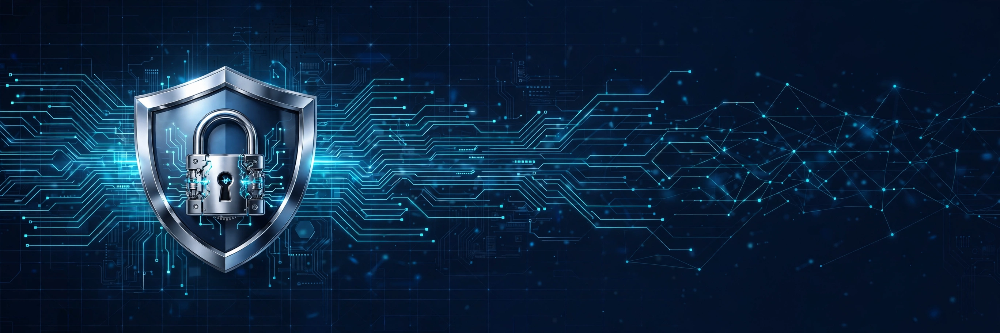
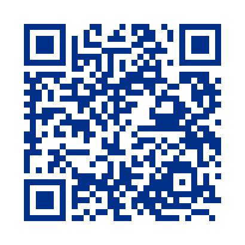
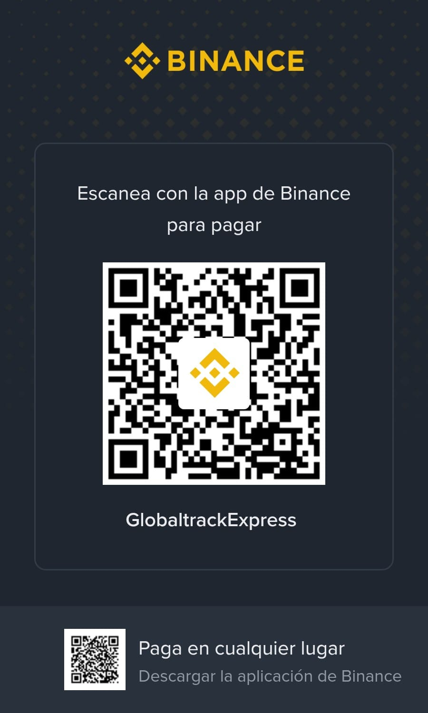

# Hola, soy José Castillo 👋

Especialista en **ciberseguridad ofensiva** y **bug bounty hunter** 🇵🇦

Mi GitHub contiene los proyectos y herramientas de mi trabajo en seguridad ofensiva: búsqueda de vulnerabilidades en programas autorizados, siempre con autorización y alcance definido.

## 📂 Proyectos

- **equipo-agentes** — sistema de agentes de IA para automatizar análisis y documentación de seguridad.
- **bug-bounty-kit** — metodología y guías profesionales para la búsqueda de vulnerabilidades.
- **kali-lab** — entorno de práctica y pruebas de seguridad ofensiva.

## 🌐 Contacto

- Portafolio: https://cyber-profile.com/u/josecastillo
- LinkedIn: https://www.linkedin.com/in/joseecastillo
- YouTube: https://www.youtube.com/@JoseCastillo_pty

## 💳 Pagos y apoyo

¿Contratas un servicio o apoyas mis proyectos? Paga directo y seguro:

- **PayPal:** https://www.paypal.com/paypalme/GlobaltrackExpress
- **Buy Me a Coffee:** https://buymeacoffee.com/josecastillo
- **GitHub Sponsors:** botón «Sponsor» en este perfil

| PayPal (QR) | Binance Pay (QR) |
|---|---|
|  |  |

## ☕ Apoya mis proyectos

Si mi contenido te sirve, invítame un café: https://buymeacoffee.com/josecastillo
